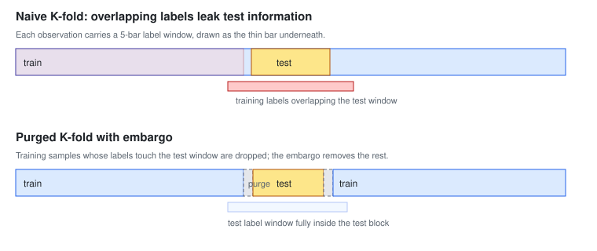

# Concepts

Every check in this library exists because a specific failure mode is common enough to be
worth automating. This page states the failure mode, the statistic that addresses it, and the
assumption the statistic rests on.

## Two kinds of dishonesty

**Selection bias.** A reported Sharpe ratio is a maximum over a search. If you evaluate $N$
strategies and report the best, you report $\max_i \widehat{SR}_i$, not $\widehat{SR}$ of a
pre-registered strategy. Under the null of zero skill, that maximum has a positive expectation
that grows with $N$ and with the dispersion of the trial Sharpe ratios.

**Evaluation leakage.** The score is computed with information that would not have been
available at decision time. Two mechanical versions dominate: overlapping labels in
cross-validation (a training sample whose label window overlaps the test window), and
point-in-time violations (a feature that was revised or published after the decision it feeds).

Both are fixed with bookkeeping, not with better models. That is why this library is mostly
about recording and arithmetic.

---

## Deflated Sharpe ratio (DSR)

Reference: Bailey & López de Prado (2014).

Start from the probabilistic Sharpe ratio, which asks how much sampling error a Sharpe ratio
carries given the sample length and the shape of the return distribution:

$$
\widehat{PSR}(SR^*) = \Phi\!\left(
\frac{(\widehat{SR} - SR^*)\sqrt{T-1}}
{\sqrt{1 - \gamma_3 \widehat{SR} + \tfrac{\gamma_4 - 1}{4}\widehat{SR}^2}}
\right)
$$

where $T$ is the number of observations, $\gamma_3$ the skewness and $\gamma_4$ the Pearson
kurtosis of the returns. Setting $SR^* = 0$ gives ordinary significance; the correction enters
by replacing $0$ with the expected maximum of $N$ worthless strategies:

$$
E[\max SR] \approx \sqrt{V[SR]}\left(
(1-\gamma)\Phi^{-1}\!\left(1-\tfrac{1}{N}\right)
+ \gamma\,\Phi^{-1}\!\left(1-\tfrac{1}{Ne}\right)
\right)
$$

with $\gamma \approx 0.5772$ the Euler-Mascheroni constant, $V[SR]$ the variance of Sharpe
ratios across the $N$ trials, and $e$ Euler's number. The deflated Sharpe ratio is
$\widehat{PSR}(E[\max SR])$: the probability that the selected strategy's true Sharpe ratio
beats what a search of that size would produce from noise alone.

Practical notes:

- **Units.** Everything above is in per-period units. Compute trial Sharpe ratios with
  `per_period_sharpes`, not with annualised numbers.
- **The trial count must be real.** The correction is only as honest as $N$. Every variant
  that was evaluated and discarded belongs in the ledger, including the ones deleted from the
  notebook.
- **Zero dispersion is an error.** If every trial has the same Sharpe ratio there is nothing to
  deflate against, and the function raises rather than returning a comforting number.

## Minimum track record length

The same variance term inverted: the number of observations needed before an observed Sharpe
ratio is distinguishable from a benchmark at a chosen confidence level.

$$
MinTRL = 1 + \left[1 - \gamma_3 \widehat{SR} + \tfrac{\gamma_4-1}{4}\widehat{SR}^2\right]
\left(\frac{\Phi^{-1}(c)}{\widehat{SR} - SR^*}\right)^2
$$

Useful when someone asks "how long does this track record need to be?" rather than "is it
significant?".

---

## Multiple-testing corrections

The DSR corrects a single selected strategy. When the question is "does *any* of these
strategies beat the benchmark?", the appropriate tools come from the data-snooping literature.

### Stationary bootstrap

Politis & Romano (1994). Blocks have geometric length with mean $L$, so the resampled series
preserves short-range dependence. All tests below use the same generator, seeded for
reproducibility. `default_block_length(n)` uses $n^{1/3}$, a standard rule of thumb for weakly
dependent data.

### White's reality check

White (2000). Let $d_{k,t}$ be the per-period return of strategy $k$ in excess of the
benchmark. The statistic is

$$
V = \max_k \sqrt{T}\,\bar{d}_k
$$

and its null distribution is obtained by re-centring the bootstrap distribution of the maximum
at the observed statistic. The p-value answers: *if no strategy had skill, how often would the
best of them look this good?*

### Hansen's SPA test

Hansen (2005). Same null, but each strategy is studentised by its own standard error before the
maximum is taken, and the bootstrap is re-centred with a $\sqrt{2\log\log T}$ correction. A
single high-variance fluke therefore cannot dominate the statistic. The result includes
`p_lower` and `p_upper` bounds; the reported p-value is the consistent one.

### Romano-Wolf stepdown

Romano & Wolf (2005). Controls the family-wise error rate and returns *which* strategies
survive, not just whether any do. Strategies are ordered by their studentised statistic and
tested sequentially against a bootstrap distribution of the maximum over the remaining set.
The surviving set is a claim about the group, not about any single strategy in isolation.

---

## Leakage screens

### Purged K-fold with embargo

López de Prado (2018), ch. 7. A training observation is removed when its label window overlaps
the test window (purging), and observations immediately after the test window are removed as
well (embargo), because features computed on overlapping windows still carry test information.

`PurgedKFold` implements the scikit-learn splitter protocol, so it drops into any pipeline that
accepts `split(X)`. `audit_splits` is the complementary tool: it inspects splits produced by
*any* library — including a hand-written loop — and reports index collisions, label overlaps
and embargo violations.



### Point-in-time availability

`check_point_in_time(feature_times, decision_times, publication_lag=...)` compares the timestamp
of the newest input used at each decision against the decision time plus the publication lag.
A violation means the decision used something that did not exist yet. This is a *contract*
check: it can verify that you passed compatible timestamps, but it cannot know whether the
timestamps you supplied are honest.

### Overlapping labels

When labels are $h$-bar forward returns, the effective sample size is roughly $T/h$, not $T$.
`label_overlap` reports the average overlap and the implied number of independent observations,
because a significance test that assumes $T$ independent draws is optimistic by a factor of
$\sqrt{h}$ in the Sharpe ratio's standard error.

### Signal delay sensitivity

Shift the signal by one bar and recompute the Sharpe ratio. A strategy that keeps most of its
edge is robust to execution delay; one that collapses was reading the bar it traded on.
`signal_delay_curve` reports the whole decay curve, not just the first point.

### Block permutation test

Shuffle blocks of the signal and recompute the signal-return statistic many times. The p-value
answers whether the *pairing* between signal and forward return is meaningful, independently of
any parametric assumption. Block shuffling keeps the signal's own autocorrelation intact, so
the null is "this signal, paired with unrelated returns".

---

## The trial ledger

`TrialLedger` writes one JSON object per line. Each record contains its sequence number, a
timestamp, the hypothesis, parameters, metrics and a data fingerprint, plus a SHA-256 digest of
that payload chained to the previous record's digest:

```
record_hash_n = SHA256(canonical_json(payload_n) + prev_hash)
```

with `prev_hash = "0" * 64` for the first record. Editing any record invalidates its own hash
and every hash after it, so `verify()` can prove that a ledger has not been edited. What it
cannot prove is that the ledger is *complete* — only disciplined logging does that.

Canonical JSON here means `sort_keys=True` with `separators=(",", ":")`, so the digest does not
depend on Python's dictionary ordering or on whitespace.

---

## Verdicts

Every report section carries one of four verdicts, and the report's overall verdict is the worst
one:

| Verdict | Meaning |
| --- | --- |
| `PASS` | The check ran and found no problem. |
| `WARN` | The result is inside a grey zone — for example a deflated Sharpe ratio between 0.90 and 0.95. |
| `FAIL` | The check found a problem that you should explain before trusting the result. |
| `INFO` | The check could not be evaluated, usually because the input was degenerate. |

A report is not a certificate. It is a record of which screens ran and what they found.
